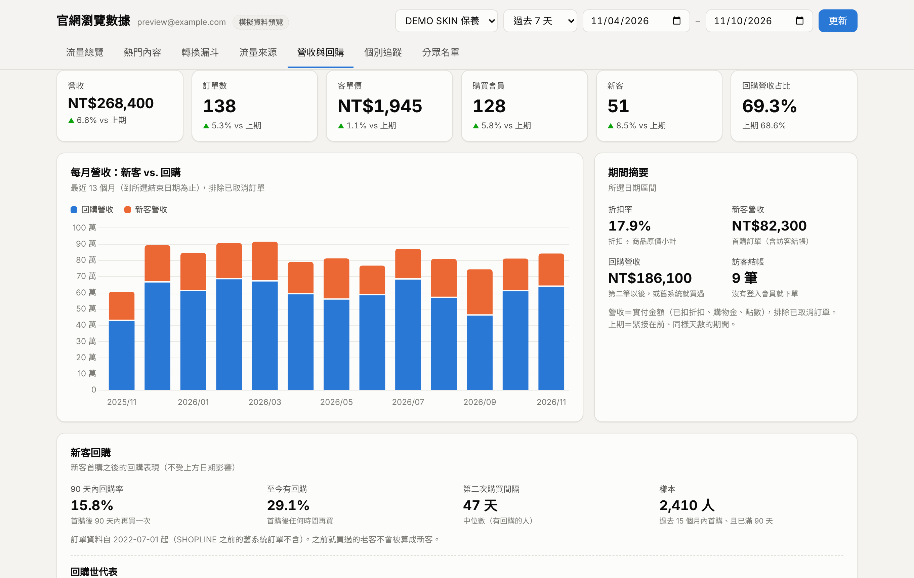
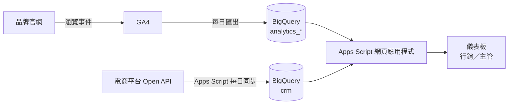

# 電商官網數據分析平台（GA4 × BigQuery × 電商平台 API）

以 Google Apps Script 與 BigQuery 自建的品牌官網分析儀表板，整合「網站瀏覽行為」與「訂單、會員資料」，
讓行銷人員不用寫 SQL 就能看流量、轉換、回購，並自助產出分眾名單。

**線上 Demo（模擬資料）：** https://jerryhung0113.github.io/ec-analytics-dashboard/

> 本專案依實際上線的內部系統重新整理。品牌名稱、專案代號與所有數字皆為虛構的模擬資料，不含任何真實會員或交易資料。



## 解決什麼問題

- 原本瀏覽資料在 GA4、訂單與會員在電商平台，兩邊無法對在一起看。
- 行銷想知道「哪些會員看了某類商品卻沒買」，需要工程支援才能撈名單。
- 外部客戶數據平台費用高；自建後雲端費用每月不到新台幣 100 元。

## 架構



- **資料管線**：GA4 每日匯出到 BigQuery；另一支 Apps Script 每天凌晨呼叫電商平台 API，增量同步會員、訂單、商品明細與優惠活動。
- **儀表板**：Apps Script 網頁應用程式，以登入者本人的權限查詢 BigQuery，權限由 Google Cloud IAM 控管。
- **個資保護**：不寫入姓名、電話、Email、地址、生日，只保留平台的會員編號。

## 功能

| 分頁 | 內容 | 資料來源 |
|---|---|---|
| 流量總覽 | 訪客、工作階段、會員與匿名裝置 | GA4 |
| 熱門內容 | 熱門頁面；商品的瀏覽、加購與實際銷量對照 | GA4 + 訂單 |
| 轉換漏斗 | 看商品 → 加入購物車 → 結帳 → 購買 | GA4 |
| 流量來源 | 管道歸類、各管道轉換表現、來源明細篩選 | GA4 |
| 營收與回購 | 新客與回購營收、優惠活動成效、同期群回購率 | 訂單 |
| 個別追蹤 | 單一會員或裝置的瀏覽時間軸 | GA4 + 會員 |
| 分眾名單 | 依瀏覽行為與會員條件篩選，匯出推播名單 | GA4 + 會員 + 訂單 |

## 技術重點

- **身分串接**：在查詢時把匿名裝置對回會員，並排除多人共用的裝置。見 [`sql/01_identity_stitching.sql`](sql/01_identity_stitching.sql)。
- **折扣後商品營收**：把訂單實付金額依比例分攤回品項。見 [`sql/02_net_revenue_allocation.sql`](sql/02_net_revenue_allocation.sql)。
- **新客判定**：以平台首筆訂單為準，並排除系統轉換前就買過的老客。
- **流量歸因修正**：從金流、超商門市地圖跳回官網的工作階段，沿用同一裝置上一次的來源，避免被誤判為新來源。
- **資料對帳**：以訂單資料驗證 GA4，發現 GA4 對組合商品的銷量嚴重低估，因此銷量與營收一律改用訂單資料。
- **成本控制**：只選取需要的欄位、依日期分區查詢、設定單次查詢上限、每位使用者一小時快取。
- **增量同步**：依更新時間抓取變動資料，分批執行以符合 Apps Script 六分鐘執行上限，可中斷續跑。

## 專案結構

```
index.html                    線上 Demo（與儀表板前端相同，未連後端時自動使用模擬資料）
apps-script/dashboard/        儀表板：Code.gs（後端查詢）、Index.html（前端）
apps-script/sync/             電商平台 API → BigQuery 每日同步
sql/                          代表性的查詢範例
docs/                         畫面截圖
```

## 如何部署到自己的環境

1. 建立 Google Cloud 專案，將 GA4 連結到 BigQuery（每日匯出）。
2. 在 BigQuery 建立 `crm` 資料集。
3. 建立兩個 Apps Script 專案，分別貼上 `apps-script/dashboard` 與 `apps-script/sync` 的檔案，並啟用 BigQuery 進階服務。
4. 修改 `Code.gs` 與 `sync.gs` 開頭的設定（專案 ID、資料集名稱）。
5. 電商平台的 API 金鑰存放在 Apps Script 的「指令碼屬性」，不寫在程式碼裡。
6. 執行 `setupSync()` 建立資料表與排程，再將儀表板部署為網頁應用程式。

## 使用技術

BigQuery SQL、Google Apps Script、JavaScript、Chart.js、GA4、REST API

## 開發方式

需求定義、資料驗證與上線由本人負責，程式開發過程使用 AI 輔助。
